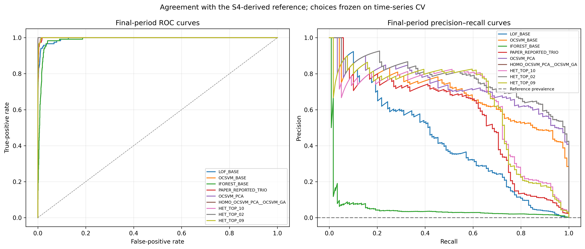

# Ionospheric S4 Anomaly Detection

**A reproducible GNSS research workflow comparing one-class models and feature-selection ensembles on the 2019 SKN dataset.**

The objective is to measure how many observations meeting an S4 scintillation reference threshold the models detect, while reporting missed positives and false alarms. The project adapts **Study III** of Tsai and Lin's feature-selection/ensemble study: LOF, One-Class SVM, and Isolation Forest; BASE/PCA/GA/C4.5 representations; and homogeneous and heterogeneous ensembles.

[Source notebook](Q4%20Paper%20Code/scintillation_anomaly_detection.ipynb) · [Executed notebook](results/2019/2019_study_iii_executed.ipynb) · [Results and provenance](results/2019/README.md) · [Reproduction guide](docs/REPRODUCIBILITY.md) · [Dataset details](docs/DATASET.md)

## Dataset and objective

`2019.zip` contains 221 daily GNSS CSV files. Its header identifies station **SKN (69.43, 20.38)**. The original loader retains observations by their actual dates, including 1 January 2020; it does not filter by the archive filename.

| Recorded dataset property | Value |
|---|---:|
| Raw observations | 2,733,026 |
| Cleaned observations | 1,783,960 |
| S4-reference positives after cleaning | 584 |
| Final-period observations | 272,742 |
| Final-period reference positives | 119 |

The unchanged preparation requires L1 lock time >60 seconds and elevation >25°. Corrected S4 is `sqrt(max(0, Total S4² − Correction S4²))`; `LABEL = 1[Corrected_S4 >= 0.20]`.

**Interpretation matters:** `Corrected_S4` is intentionally retained as an input. Consequently, these scores describe agreement with an S4-derived reference, not independent confirmation of physical scintillation or advance forecasting. “Anomalies detected” below means reference-positive observations, not independent events.

## Method

1. Keep the original preparation and exploratory analysis unchanged.
2. Evaluate with five expanding folds grouped by date, before the existing final chronological holdout.
3. Fit preprocessing, selection, and OCC models on normal/class-0 training rows only; reproducibly sample at most 5,000 fitting rows across dates.
4. Use normal-data K-means pseudo-classes (`K=10, 50, 100`) for GA and genuine C4.5-family selection through Weka J48. Retain S4 in every representation; PCA retains 80% variance of the other predictors alongside S4.
5. Train LOF, RBF OCSVM, and Isolation Forest; select GA/C4.5 cluster settings using development CV ROC-AUC.
6. Compare 12 single models, 33 homogeneous combinations, 19 cross-pool designs, and the paper-reported trio: **65 candidates**. Audit actual algorithm diversity rather than assuming every top-N design is heterogeneous.
7. Average normalized scores. Report the paper's 0.5 rule as primary; separately freeze supplementary F1/F2/FPR thresholds on development CV.
8. Export all final metrics, confusion matrices, ROC/PR curves, feature-selection and temporal diagnostics, and date-block bootstrap intervals.

This is a documented adaptation, not an exact replication: chronological evaluation, forced S4, the training cap, and explicitly stated choices for underspecified bagging/normalization/GA details differ from the paper. See the notebook and [method mapping](results/2019/tables/study_iii_method_steps.csv).

## Recorded 2019 findings

Family/model choices were frozen using development CV; the final period was **29 November 2019–1 January 2020**.

| Configuration | TP | FP | FN | Precision | Recall | F1 |
|---|---:|---:|---:|---:|---:|---:|
| Paper-reported trio, paper threshold | 116 | 2,291 | 3 | 4.82% | 97.48% | 0.092 |
| CV-selected heterogeneous top 10, paper threshold | 119 | 49,529 | 0 | 0.24% | 100% | 0.005 |
| Same top 10, CV-selected F1 threshold | 40 | 12 | 79 | 76.92% | 33.61% | 0.468 |

High recall at the paper threshold carries a substantial false-alarm cost. A validation-selected threshold reduces false alarms but misses positives. The test period had also been evaluated in an earlier baseline run, so it is not a wholly unseen prospective validation cohort. These results do not establish universal ensemble superiority.



Browse [all 260 evaluation rows](results/2019/tables/final_test_metrics_all_models.csv), [primary family comparisons](results/2019/tables/q4_study_iii_primary_concise.csv), and [supplementary operating points](results/2019/tables/q4_selected_ensembles_operating_points.csv). The downloadable HTML report and PNG/PDF figures are in [results/2019](results/2019/README.md).

## Run locally

Use **Python 3.12** (recorded: 3.12.14), a full **Java JDK 21** (recorded: 21.0.13), CPU, internet for package/Maven downloads, and sufficient RAM/disk. A GPU is unnecessary. Linux is the reference platform; macOS uses the same commands; Windows users should use WSL2. Allow at least 16 GB RAM and 3 GB free disk as a planning estimate, not a measured minimum. A full CPU run can take tens of minutes or longer.

1. Clone the repository and enter it:

   ```bash
   git clone https://github.com/YoushaAbdullah/Ionosphere-S4-Anomaly-Detection.git
   cd Ionosphere-S4-Anomaly-Detection
   ```

2. Install a full JDK and verify `java -version`. For Ubuntu/Debian:

   ```bash
   sudo apt-get update
   sudo apt-get install -y openjdk-21-jdk-headless
   ```

   On macOS, install Temurin/OpenJDK 21 and ensure `java` is on PATH.

3. Create an isolated environment and install the hash-locked dependencies:

   ```bash
   python3.12 -m venv .venv
   source .venv/bin/activate
   python -m pip install --require-hashes -r requirements.txt
   ```

4. Obtain the original [`2019.zip`](https://drive.google.com/file/d/1OG_aty11RvXqJ8G3JuXn6sv2QWq_6L-h/view), with access from its owner if needed. Save it as `data/2019.zip`. It is deliberately not redistributed in Git. The runner checks its SHA-256 before fitting.

5. Check the setup, then run:

   ```bash
   python run_experiment.py --data data/2019.zip --check-only
   python run_experiment.py --data data/2019.zip --output runs/2019
   ```

   Open `runs/2019/2019_study_iii_executed.ipynb` afterward. Tables, figures, feature-selection audits, full scores, and a report appear in `runs/2019/study_iii_results/`; a ZIP is generated alongside that folder. Use a **new output directory** for every run.

No commit or push is needed to execute the code. The portable runner executes the source notebook's scientific cells directly and supplies file/plot adapters; it does not maintain a second modelling implementation.

## Run on Codex Cloud

1. Connect this repository to a Codex Cloud task and check out the version you want to reproduce.
2. Provide `2019.zip` in the task workspace, or download it through an authorized Drive connection; do not commit the raw data. Check that the environment has adequate RAM/disk, Python 3.12, a full JDK 21, and access to PyPI/Maven.
3. Follow local steps 3–5 in the cloud terminal. If shell activation does not persist between calls, invoke `.venv/bin/python` explicitly.
4. Keep the task alive until the manifest says `completed`; download the output ZIP or save outputs before the temporary environment expires.

## Run on Google Colab

The pinned subprocess route avoids changing Colab's shared Python packages and preserves the original notebook cells.

1. Open a fresh CPU Colab notebook, enable a sufficiently large RAM runtime if available, then run:

   ```python
   !git clone https://github.com/YoushaAbdullah/Ionosphere-S4-Anomaly-Detection.git
   %cd Ionosphere-S4-Anomaly-Detection
   !pip -q install uv==0.13.9
   !uv python install 3.12.14
   !uv venv --python 3.12.14 .venv
   !uv pip sync --python .venv/bin/python --require-hashes requirements.txt
   !apt-get -qq update
   !apt-get -qq install -y openjdk-21-jdk-headless
   ```

2. Upload `2019.zip` to this directory using Colab's Files sidebar, or copy it from your mounted Drive. Browser uploads may be slow; the archive is about 122 MB.
3. Run preflight and the full experiment in separate cells:

   ```python
   !.venv/bin/python run_experiment.py --data 2019.zip --check-only
   !.venv/bin/python run_experiment.py --data 2019.zip --output runs/2019
   ```

4. Download the notebook and generated result archive from the Files sidebar. Colab can disconnect or exhaust RAM; use a suitable runtime and retain outputs before it is recycled.

For interactive viewing, the source notebook also has an [Open in Colab link](https://colab.research.google.com/github/YoushaAbdullah/Ionosphere-S4-Anomaly-Detection/blob/main/Q4%20Paper%20Code/scintillation_anomaly_detection.ipynb). Its original upload cell works in Colab, but the isolated runner above is the supported pinned reproduction route.

## Reproducibility and repository contents

```text
Q4 Paper Code/scintillation_anomaly_detection.ipynb  # Scientific source
run_experiment.py                                  # Portable execution and preflight
requirements.in / requirements.txt                 # Recorded versions / hash lock
docs/                                              # Dataset and reproduction details
results/2019/                                      # Executed notebook, tables, figures, audits
verify_results.py                                  # Offline artifact and invariant checks
```

Run `python verify_results.py` to verify the checked-in result bundle without installing ML dependencies or downloading data. Full per-observation scores and selector audits are distributed as a [release asset](https://github.com/YoushaAbdullah/Ionosphere-S4-Anomaly-Detection/releases/tag/study-iii-2019-v1); they are too large for ordinary Git blobs.

Seeds, package versions, data/source hashes, dates, model parameters, selected features, and historical cache/postprocessing provenance are recorded. **Reproducible inputs and procedures are supplied; bit-for-bit model outputs across every operating system, BLAS implementation, Java build, or hardware configuration are not guaranteed.** The full historical fit is not represented as a newly executed fresh run when only packaging checks are performed. See [validation and known limits](docs/REPRODUCIBILITY.md).

## Reference

Tsai and Lin (2021), *Feature Selection and Ensemble Learning Techniques in One-Class Classifiers: An Empirical Study of Two-Class Imbalanced Datasets*, IEEE Access. [DOI: 10.1109/ACCESS.2021.3051969](https://doi.org/10.1109/ACCESS.2021.3051969).

The reference paper and raw dataset retain their respective owners' rights. This repository does not grant redistribution rights for either; no new software license is asserted here.
